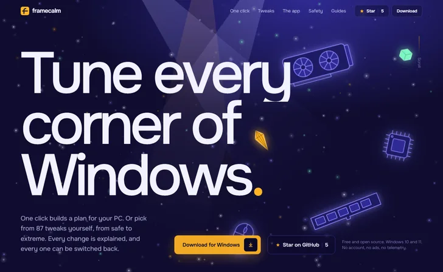
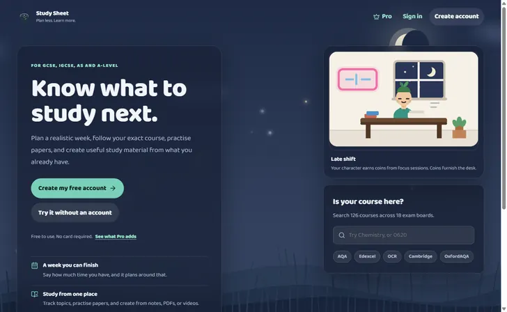
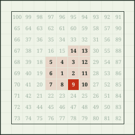

<picture>
  <source media="(prefers-color-scheme: dark)" srcset="assets/name-dark.svg">
  
</picture>

  I'm krezio. I'm a pure maths student, and I ship software.
    
  
   
<!-- github:start -->
Joined GitHub 5 years ago · 123 contributions in the last 7 days
<!-- github:end -->

## Built

<table>
  <tr>
    <td width="50%" valign="top">
      
       <b><a href="https://roomy.krezio.xyz">Roomy</a></b> · C# · WPF · open source
       A free disk cleaner for Windows. It shows what's filling your drive in plain English and clears the safe stuff in one click.
       <a href="https://roomy.krezio.xyz">roomy.krezio.xyz</a> · <a href="https://github.com/krezio/roomy">code</a>
    </td>
    <td width="50%" valign="top">
      
       <b><a href="https://framecalm.krezio.xyz">Framecalm</a></b> · C# · WPF · open source
       A free Windows optimizer for games. One click builds a plan for your PC from 87 tweaks, each explained and each undoable.
       <a href="https://framecalm.krezio.xyz">framecalm.krezio.xyz</a> · <a href="https://github.com/krezio/framecalm">code</a>
    </td>
  </tr>
  <tr>
    <td width="50%" valign="top">
      
       <b><a href="https://studysheet.org">StudySheet</a></b> · React · Supabase · 2k+ users
       Study trackers, topic organisation and timetabling for GCSE and A Level students.
       <a href="https://studysheet.org">studysheet.org</a>
    </td>
    <td width="50%" valign="top">
      
       <b><a href="https://findauni.org">FindAUni</a></b> · Next.js · Cloudflare · 27,000 courses
       Search and compare UK universities, built on official HESA data.
       <a href="https://findauni.org">findauni.org</a>
    </td>
  </tr>
</table>

<b>More things I've made</b>

 

- **Sharp Studios**: my studio, building websites and web apps for cafes and service businesses, from design to hosting.
- **[InstaWrapped](https://github.com/krezio/InstaWrapped)**: an AI report that analyses your chats. Still in development.
- **Floating to-do**: a tiny always-on-top task panel for the desktop, in Tauri and React.
- **[VM-Creator](https://github.com/krezio/VM-Creator)**: a Discord bot that spins up Azure virtual machines from one command.

## Stack

<picture>
  <source media="(prefers-color-scheme: dark)" srcset="assets/stack-dark.svg">
  
</picture>

## Project Euler

<!-- euler:start -->
<picture>
  <source media="(prefers-color-scheme: dark)" srcset="assets/euler-dark.svg">
  
</picture>

**Problem of the day, 17 November 2026**

### [Problem 13: Large Sum](https://projecteuler.net/problem=13)

I'm working through [Project Euler](https://projecteuler.net/) one problem a day. 14 of the first 100 solved so far, spiralling out from 1 on the right; today's is the red square.

[Read today's problem on Project Euler →](https://projecteuler.net/problem=13)
 
<!-- euler:end -->

∎

